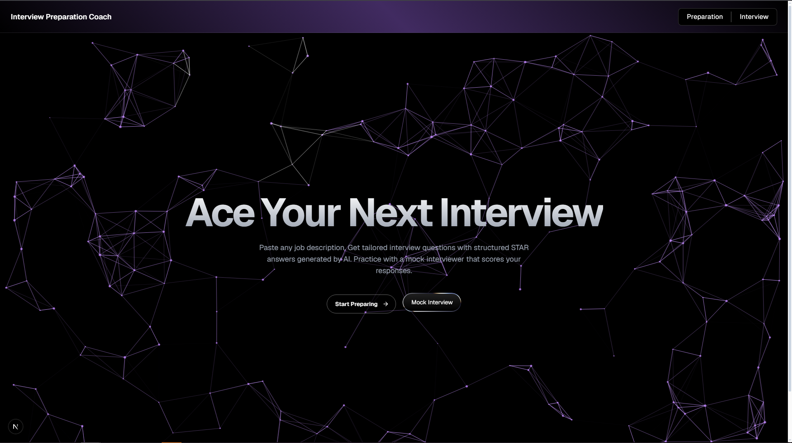

<h1 align="center">HireReady AI — AI-Powered Mock Interview Coach</h1>

<p align="center">
  
  
  
  
  
  
</p>

<h3 align="center">Practice Smarter. Interview Better. Get Hired Faster.</h3>

<p align="center">
  <strong>HireReady AI</strong> is an intelligent mock HR interview simulator and prep platform. It provides personalized interview questioning based on your target role and experience, real-time AI evaluation, speech-to-text recognition, text-to-speech audio playback, and comprehensive performance scorecards with targeted improvement plans.
</p>

---

## 🚀 Key Features

- **Personalized HR Mock Interviews (`/interview`)** — Tailored interviews adapting to your target role, experience level, skill set, and interview difficulty.
- **Voice-Enabled Simulation** — Interactive voice dictation (Speech Recognition) and natural text-to-speech voice playback for a realistic interview feel.
- **Real-Time Scoring & Adaptive Feedback** — Dynamic scoring out of 10 for each response with constructive recommendations and STAR alignment.
- **In-Depth Performance Analytics** — Full post-interview report with overall letter grade, category breakdowns, strengths, growth areas, and personalized action items.
- **Job Description Question Generator (`/prep`)** — Paste any job description to generate 10 tailored behavioral, technical, and culture-fit interview questions with complete STAR-model answers.
- **Rapid Practice Mode (`/practice`)** — Fast-paced practice mode for quick answer drill-downs.
- **Ultra-Modern Glassmorphic UI** — Sleek dark theme, fluid Framer Motion micro-interactions, and custom WebGL shaders.

---

## Screenshots

<p align="center">
  
  <br />
  <em>Landing page with animated particle canvas and quick access to both modes.</em>
</p>

<br />

<p align="center">
  
  <br />
  <em>Mock interview mode with real-time AI feedback and scoring.</em>
</p>

---

## Tech Stack

| Layer | Technology |
|-------|------------|
| Frontend | Next.js 16, React 19, TypeScript |
| Styling | Tailwind CSS 4 |
| AI Backend | Google Gemini 2.5 Flash (streaming via SSE) |
| Animations | Framer Motion, Custom WebGL Shaders |
| Deployment | Render |

---

## Getting Started

### Prerequisites

- Node.js 18 or later
- A Google Gemini API key (free at [aistudio.google.com](https://aistudio.google.com))

### Installation

```bash
git clone https://github.com/encode-abdullah/AI-Interview-Coach.git
cd ai-interview-coach
npm install
```

### Environment Variables

Create a `.env.local` file in the root directory:

```
GEMINI_API_KEY=your_api_key_here
```

### Run Development Server

```bash
npm run dev
```

Open [http://localhost:3000](http://localhost:3000) in your browser.

---

## Deployment

The project is configured for one-click deployment on Render using the included `render.yaml`.

### Deploy to Render

1. Fork or clone this repository to your GitHub account.
2. Log in to [render.com](https://render.com) and create a new **Web Service**.
3. Connect your GitHub repository (`encode-abdullah/AI-Interview-Coach`).
4. Render will auto-detect the `render.yaml` configuration.
5. Under **Environment Variables**, add:
   - `GEMINI_API_KEY` -- your Google Gemini API key from [aistudio.google.com](https://aistudio.google.com)
6. Click **Create Web Service** and wait for the build to complete (~2-3 minutes).
7. Your app will be live at `https://ai-interview-coach.onrender.com`.

### Environment Variables on Render

| Variable | Description | Required |
|----------|-------------|----------|
| `GEMINI_API_KEY` | Google Gemini API key for AI responses | Yes |

---

## How It Works

1. **Paste a Job Description** -- Copy any job listing from LinkedIn, Indeed, or a company careers page.
2. **Generate Questions** -- The AI analyzes the role and generates 10 tailored interview questions with STAR answers.
3. **Practice Mock Interviews** -- Switch to mock interview mode to practice answering questions out loud. The AI scores each response and tells you what to improve.

---

## Project Structure

```
ai-interview-coach/
  app/
    api/generate/route.ts    # Gemini API integration with SSE streaming
    prep/page.tsx            # Question generation page
    practice/page.tsx        # Mock interview page
  components/
    QuestionCard.tsx         # Expandable question card with STAR answer
    CopyButton.tsx           # Clipboard copy utility
    ui/
      hero-canvas.tsx        # Animated particle network canvas
      gradient-wave.tsx      # WebGL gradient wave background
      flow-button.tsx        # Arrow-slide animation button
      liquid-metal-button.tsx # Shader-based metallic button
  lib/
    prompts.ts               # AI prompt templates
```

---

## Future Improvements

- User accounts with saved prep history
- Voice-based mock interviews with speech-to-text
- Resume parsing to auto-fill job details
- Support for multiple AI models (GPT, Claude, Llama)

---

## License

This project is licensed under the MIT License.
